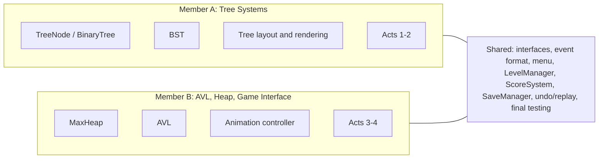

# Vault Heist: The Living Vault, Two-Person Parallel Development Roadmap

| Item | Details |
|---|---|
| Project | Vault Heist: The Living Vault (BinaryTree, BST, AVL, MaxHeap) |
| Team | Member A: Tree Systems, Member B: AVL, Heap and Game Interface |
| Source | Uploaded roadmap text (contains the ChatGPT-generated plan). Assignments are taken from it exactly. |
| Estimated duration | 16 to 24 working days, assuming both members work consistently. This is an estimate, not a deadline. |

## 1. Overview

The project is divided by modules, not by levels or by randomly splitting files. Member A owns the tree family (BinaryTree and BST) and its gameplay. Member B owns the balanced and heap structures (AVL and MaxHeap) and the animation and game interface work for them. Both members develop in parallel from the first phase, agree on interfaces before coding, and integrate in three milestones instead of at the end.

- Both members code at the same time, and neither waits for the other to finish all of their work.
- Interfaces are defined first, so merge conflicts are avoided.
- Each module can be tested independently.
- Integration happens gradually, after each phase.
- Both members must understand the complete implementation and attend the demonstration and viva.

## 2. Team Division

### Member A: Tree Systems

- TreeNode and BinaryTree
- Traversals: preorder, inorder, postorder, level order
- Tree reconstruction
- Height, diameter, LCA, mirror
- BST insertion, searching and deletion
- BST range queries, successor and predecessor
- Tree validation
- Tree layout and rendering
- Act 1 and Act 2 gameplay
- Unit tests for BinaryTree and BST

### Member B: AVL, Heap and Game Interface

- AVLTree implementation
- Balance factors and height updates
- LL, RR, LR and RL rotations
- subtreeSize, kth and rank
- MaxHeap implementation
- buildMaxHeap, siftUp and siftDown
- Extract Max and Heap Sort
- Heap tree and array visualization
- Animation controller
- Act 3 and Act 4 gameplay
- Unit tests for AVL and Heap

### Shared Responsibilities (both members)

- Architecture and interfaces
- Event format agreement
- Main menu and campaign integration
- LevelManager, ScoreSystem and SaveManager
- Undo/replay integration
- Final testing, benchmarking and documentation

> **Important:** Member B can start AVL development using the agreed BST interface and a temporary BST implementation or mock. Member B does not need to wait for Member A to finish the BST.

## 3. Module Ownership Diagram



## 4. Phase-by-Phase Plan

Both members work in parallel in every phase. Do not finish all of Member A's work and then start Member B's work.

### Phase 0: Architecture Agreement (both members, before coding)

Estimated 0.5 to 1 day (the timeline table lists 1 day).

| Task | Responsibility |
|---|---|
| Folder structure | Both |
| Programming language and GUI framework | Both |
| TreeNode and BSTNode interfaces | Both |
| AVLNode interface | Both |
| MaxHeap interface | Both |
| Event definitions | Both |
| Common function naming | Both |
| Git repository and branches | Both |

Illustrative interfaces (finalize parameters and return types together):

```cpp
class BinaryTree {
public:
    void preorder();
    void inorder();
    void postorder();
    void levelOrder();
    int height();
    int diameter();
};

class BST {
public:
    void insert(int key);
    bool search(int key);
    void deleteNode(int key);
};

class AVLTree {
public:
    void insert(int key);
    void deleteNode(int key);
    void rotateLeft();
    void rotateRight();
    int kth(int k);
    int rank(int key);
};

class MaxHeap {
public:
    void buildMaxHeap();
    void siftDown(int i);
    void siftUp(int i);
    int extractMax();
    void heapSort();
};
```

### Phase 1: Independent Core Implementation (3 to 5 days, parallel)

| Step | Member A: Tree foundation | Member B: Independent structures |
|---|---|---|
| 1 | Implement TreeNode. | Implement MaxHeap array representation. |
| 2 | Implement BinaryTree. | Implement buildMaxHeap. |
| 3 | Implement all four traversals. | Implement siftUp and siftDown. |
| 4 | Implement reconstruction. | Implement extractMax. |
| 5 | Implement height and diameter. | Implement Heap Sort. |
| 6 | Implement LCA and mirror. | Implement isMaxHeap. |
| 7 | Implement initial unit tests. | Start AVL using the agreed node and BST interfaces. |

**Integration milestone 1:** Both members merge into main, run basic tests, and verify that both modules compile independently.

### Phase 2: Advanced Data Structures (3 to 5 days, parallel)

| Step | Member A: BST | Member B: AVL and Heap completion |
|---|---|---|
| 1 | Implement BST insertion. | Complete AVL insertion and deletion. |
| 2 | Implement search. | Implement all four rotation cases. |
| 3 | Implement deletion (all three cases). | Implement balance factor. |
| 4 | Implement min/max. | Implement height and subtreeSize updates. |
| 5 | Implement successor/predecessor. | Implement kth and rank. |
| 6 | Implement range query. | Implement AVL validation. |
| 7 | Implement BST validation. | Complete heap unit tests. |
| 8 | Complete BST unit tests. | Verify Heap Sort against sorted reference arrays. |

**Integration milestone 2:** Connect AVL with the finalized BST, test rotations and deletion, verify all data structure invariants, and run all model unit tests.

### Phase 3: GUI and Visualization (4 to 6 days, parallel)

Model APIs are complete at this point, so both members build their interfaces on top of them.

| Member A: Tree visualization | Member B: Advanced visualization |
|---|---|
| Tree LayoutEngine | Event animation controller |
| Tree node and edge rendering | Animation queue, pause and step |
| Tree selection and highlighting | AVL rotation animations |
| Traversal animations | Balance factor and subtreeSize badges |
| BST insertion and deletion animations | Heap tree visualization |
| Search path visualization | Heap array visualization |
| Tree operation panel | Synchronization between tree and array |
| Act 1 and Act 2 screens | Act 3 and Act 4 screens |

**Integration milestone 3:** Connect both visualizations to the same application and event architecture. Test that GUI operations correctly update the underlying models.

### Phase 4: Game Systems and Integration (3 to 4 days, together with separate ownership)

| Member A | Member B |
|---|---|
| Level data for Acts 1 to 2 | Level data for Acts 3 to 4 |
| Traversal and reconstruction level logic | AVL and Heap level logic |
| Tree-related win conditions | AVL and Heap win conditions |
| Tree-related hints | Rotation and Heap hints |
| Tree serialization tests | Heap serialization tests |

**Shared work in Phase 4 (both members):**

- Main menu and campaign map
- LevelManager
- ScoreSystem and alarm meter
- EventLog
- Undo and replay
- Save and load
- Sandbox
- Endless mode
- Final application integration

Assign one owner to each shared module before implementation to prevent two people editing the same files at once. The source gives this example: Member A owns LevelManager and Member B owns AnimationController.

### Phase 5: Testing, Benchmarking and Submission (2 to 3 days, parallel and together)

| Member A | Member B |
|---|---|
| BinaryTree tests | AVL tests |
| BST tests | Heap tests |
| Act 1 to 2 GUI testing | Act 3 to 4 GUI testing |
| Tree performance tests | Heap performance tests |
| Tree documentation | AVL and Heap documentation |

**Shared work in Phase 5 (both members):**

- Test the complete campaign
- Fix integration bugs
- Verify undo/replay and save/load
- Prepare the report
- Capture required screenshots (AVL rotation screenshots, heap demonstrations, benchmarking results)
- Prepare the demonstration and viva

The project specifically requires unit tests, GUI testing, AVL rotation screenshots, heap demonstrations and benchmarking results. Neither member should leave these until the last day.

## 5. Visual Timeline

```mermaid
gantt
    title Development schedule (16 to 24 working days, lower estimates shown)
    dateFormat X
    axisFormat %d
    section Phases
    Phase 0 Architecture          :p0, 0, 1
    Phase 1 Core structures       :p1, after p0, 3
    Phase 2 Advanced structures   :p2, after p1, 3
    Phase 3 GUI and visualization :p3, after p2, 4
    Phase 4 Game integration      :p4, after p3, 3
    Phase 5 Testing and submission:p5, after p4, 2
```



Milestones: M1 after Phase 1, M2 after Phase 2, M3 after Phase 3.

## 6. Repository Structure and Git Workflow

```
Vault-Heist/
├── src/
│   ├── core/            events/, validator/, common/
│   ├── structures/      binary_tree/, bst/, avl/, heap/
│   ├── visualization/   tree/, heap/, renderer/, animation/
│   ├── game/            levels/, scoring/, campaign/, save/
│   └── ui/
├── tests/               binary_tree/, bst/, avl/, heap/
├── levels/
├── docs/
├── README.md
└── main.cpp
```

Branches:

```
main
 ├── feature/binary-tree-bst    (Member A)
 └── feature/avl-heap-gui       (Member B)
```

### Git Rules

1. Never work directly on main.
2. Commit small, working modules.
3. Push changes regularly.
4. Merge through Pull Requests.
5. Never modify another member's module without coordination.
6. Every merged module must compile and pass its tests.

## 7. Integration Milestones

| Milestone | When | What must be true |
|---|---|---|
| M1 | After Phase 1 | Both modules merged into main, compile independently, basic tests pass. |
| M2 | After Phase 2 | AVL connected to final BST, rotations and deletion tested, all invariants verified, all model unit tests pass. |
| M3 | After Phase 3 | Both visualizations running in the same application and event architecture; GUI operations update the models correctly. |

**Architecture rule:** Data structures stay independent of the GUI. The required flow is model, then event log, then animation controller, then renderer. Both members follow the same event contract.

## 8. Timeline Summary

| Phase | Duration | Working arrangement |
|---|---|---|
| Phase 0: Architecture | 0.5 to 1 day (timeline table: 1 day) | Together |
| Phase 1: Core structures | 3 to 5 days | Parallel |
| Phase 2: Advanced structures | 3 to 5 days | Parallel |
| Phase 3: GUI and visualization | 4 to 6 days | Parallel |
| Phase 4: Game integration | 3 to 4 days | Together, with separate ownership |
| Phase 5: Testing and report | 2 to 3 days | Parallel, plus together |
| **Total** | **16 to 24 days** | |

## 9. Shared Task Board (Starter)

The source recommends a shared task board with owners, dependencies and merge status. This starter uses only the owners and dependencies stated in the source.

| Task | Owner | Depends on | Status | Merged |
|---|---|---|---|---|
| Interface agreement (Phase 0) | Both | None | | |
| BinaryTree and traversals | Member A | Phase 0 | | |
| MaxHeap and Heap Sort | Member B | Phase 0 | | |
| AVL start on BST interface (or mock) | Member B | Phase 0 | | |
| BST complete with validation | Member A | Phase 1 | | |
| AVL rotations, kth and rank | Member B | BST interface (final BST at M2) | | |
| Tree layout and traversal animations | Member A | Model APIs (Phase 2) | | |
| Animation controller | Member B | Event contract (Phase 0) | | |
| AVL and heap visualization | Member B | AVL and Heap APIs (Phase 2) | | |
| LevelManager and shared modules | Shared, one owner per module | M3 | | |
| Acts 1 to 4 level data and win conditions | Member A (Acts 1-2), Member B (Acts 3-4) | Phase 3 integration | | |
| Testing, screenshots, report, viva prep | Both | Phase 4 | | |

## 10. Points to Confirm Together

- All interfaces above are illustrative. Finalize parameters and return types together in Phase 0.
- Phase 0 is listed as 0.5 to 1 day in the phase section and as 1 day in the timeline table. The schedule uses the range.
- The owner examples for shared modules (LevelManager for Member A, AnimationController for Member B) are suggestions from the source. Confirm them before Phase 4.
- Add any tasks your team needs to the task board, but keep the member assignments unchanged unless both members agree.
